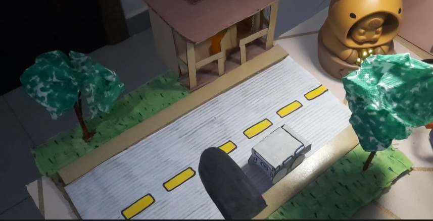
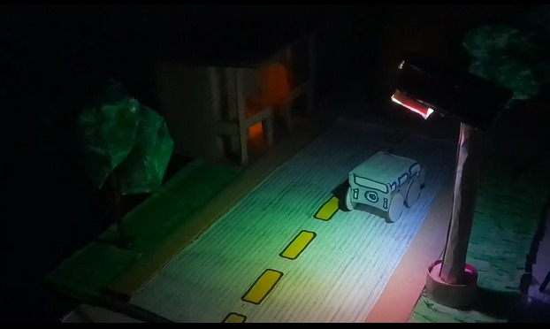
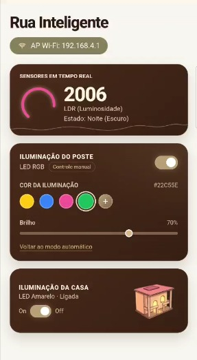

# 🏘️ Rua Inteligente 🤎

Uma maquete de rua que usa uma **ESP32-S2** para cuidar da iluminação. O sensor percebe quando escurece e acende o poste; pela página no celular também dá para escolher a cor do poste e controlar a luz da casa.

> Feito com carinho, fios, LEDs e um pouquinho de código ☕

## 📸 Um passeio pela maquete

**De dia** — o sensor LDR percebe a claridade do ambiente.



**À noite** — o poste acende quando o ambiente fica escuro.



**No celular** — painel para acompanhar o sensor e controlar as luzes.



## 🟤 O que dá para fazer

- Ver a leitura do sensor de luminosidade em tempo real.
- Deixar o poste acender e apagar sozinho conforme a claridade.
- No modo manual, ligar o poste, escolher uma cor e ajustar o brilho.
- Ligar e desligar a luz amarela da casa.
- Acessar o painel pelo Wi-Fi criado pela própria ESP32 — sem precisar de internet.

## 🧰 O que usamos

- ESP32-S2 (placa LOLIN S2 Mini)
- Sensor LDR
- LED RGB para o poste
- LED amarelo para a casa
- Firmware em C com ESP-IDF e FreeRTOS
- Interface feita com HTML, CSS e JavaScript

## 🔌 Ligações

| Peça | GPIO |
| --- | :---: |
| Sensor LDR | 1 |
| LED RGB — vermelho | 18 |
| LED RGB — azul | 19 |
| LED RGB — verde | 20 |
| LED amarelo da casa | 21 |

*As saídas verde e azul estão ajustadas no firmware para combinar com a ligação atual do LED RGB.*

## 🚀 Como colocar para funcionar

1. Abra o projeto no VS Code com a extensão **PlatformIO** instalada.
2. Conecte a ESP32-S2 pelo USB.
3. Compile e grave o firmware:

   ```sh
   pio run
   pio run --target upload
   ```

4. No celular, conecte-se ao Wi-Fi **PorteESP** e abra `http://192.168.4.1`.

   A senha do Wi-Fi é a configurada no firmware, em `src/main.c`.

Para acompanhar as mensagens da placa pelo terminal:

```sh
pio device monitor
```

## 📁 Onde fica cada coisa

- `src/` — código da ESP32 e servidor web.
- `include/` — página, estilos, JavaScript e imagens.
- `platformio.ini` — configuração de compilação da placa.

---

🤎 **Rua Inteligente** — uma rua pequena, com ideias grandes.
